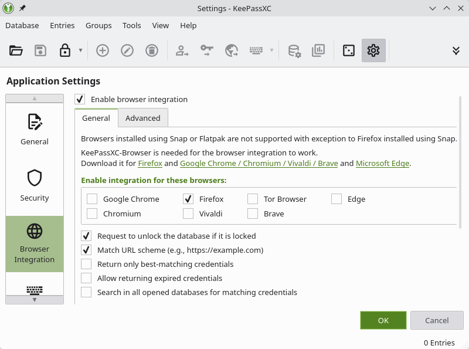
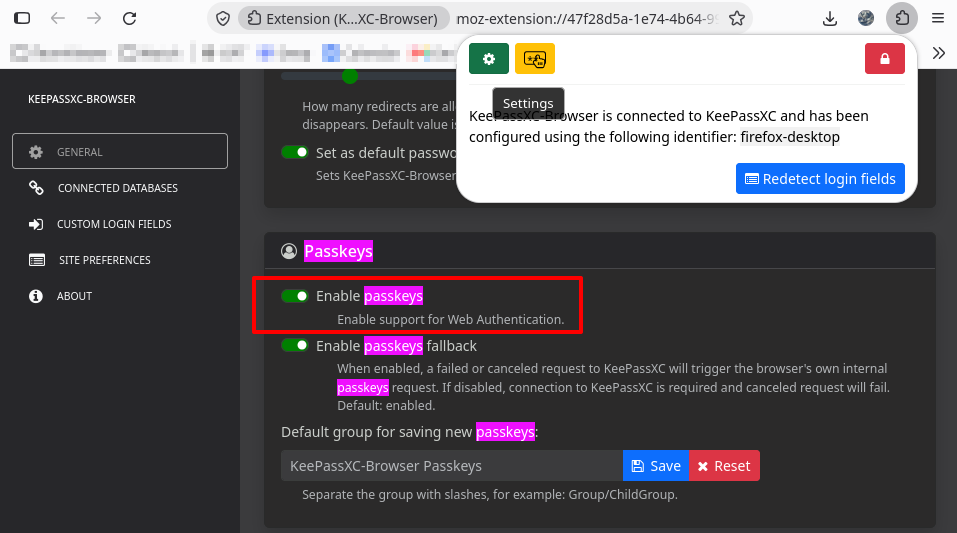
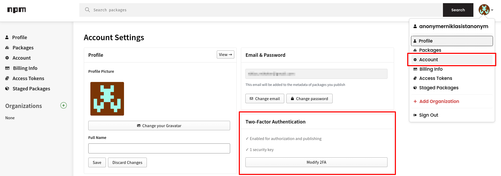
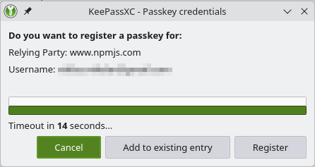
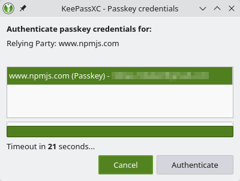
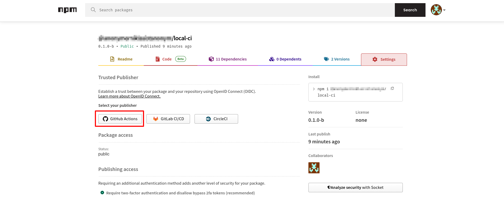

# DEV

## Logs

Logs are created using `pino` in JSON format and are best viewed using:

```sh
# -L is the log level
# -m highlights specific strings in the output
cat local-ci.log | npx pino-pretty -L info -m optionalHighlight
```

## IDEs

### VSCode

#### Setup

There already exist recommended settings and defaults in `.vscode`.

## NPM

### Create package

```sh
npm run build
npm pack
# Or without creating a file
npm pack --dry-run
```

> [!NOTE]
> `npm` uses the `files` entry in `package.json` as an allow list so you do not add more than `dist` and `README.md` to the package (next to the defaults `LICENSE`, `README` and `package.json`).

Install the package in a new repository:

```sh
npm run build
TARBALL=$(npm pack --silent)
set -x
NPM_PACK_PATH="$(pwd)/$TARBALL"
set +x
rm -rf /tmp/test-package
mkdir /tmp/test-package || exit 1
cd /tmp/test-package || exit 1
npm init -y
npm install "$NPM_PACK_PATH"
npx @anonymerniklasistanonym/local-ci --version
```

### Manual publishing

To publish on `npm` you first need to login:

```sh
# Displays a URL you need to visit and log in with your npm account
npm login
```

Then you need to enable 2FA which can for example be done using KeePassXC.
Create a new database and go to settings where you can enable the browser integration as well as get the link to the _official_ browser extension.



When the extension is installed you click the icon and connect it to your KeePassXC client.
Then you go to the extension settings and enable its _passkey_ integration:



> [!NOTE]
> I disabled the next option _Enable passkeys fallback_ but am not sure if this is necessary.

Now go back to the `npm` web page, select your profile and account and then _enable 2FA_.



When `npm` asks for a security key the KeePassXC client should now automatically pop up and prompts you to add a passkey.

> [!NOTE]
> The popup didn't show up on my first try but after I refreshed the page and clicked the button again it showed up.



Then you can publish:

```sh
npm run build
npm publish --access public
# or if its a beta version
npm publish --access public --tag beta
```

In the last step you are prompted to authenticate yourself by logging yourself in on the `npm` website which will again automatically trigger KeePassXC.



> [!NOTE]
> If your name is too generic, similar to existing projects or for other reasons you might be prompted to modify the name in `package.json` and prefix it with your username.

### `npm` `README`

The `npm` `README` does not show images or do relative file links.
So be sure to for example replace those paths with GitHub raw links.

### GitHub Actions integration

For automatic publishing of new versions a trusted publisher must be added to your package.
For this login on the `npm` website and then go to the _Packages_ page where all published packages are located.
Select the one you want to automatically publish and go to the _Settings_ tab.



Then select for example _GitHub Actions_ and fill in the required information.
Make also sure to add a `repository` entry to the `package.json` which directly links to this repository.

> [!NOTE]
> Per default `npm` only allows staged publishing meaning you need to review the package before it will be released.
> If you want to directly publish you need to enable the checkbox for it to also directly publish.
