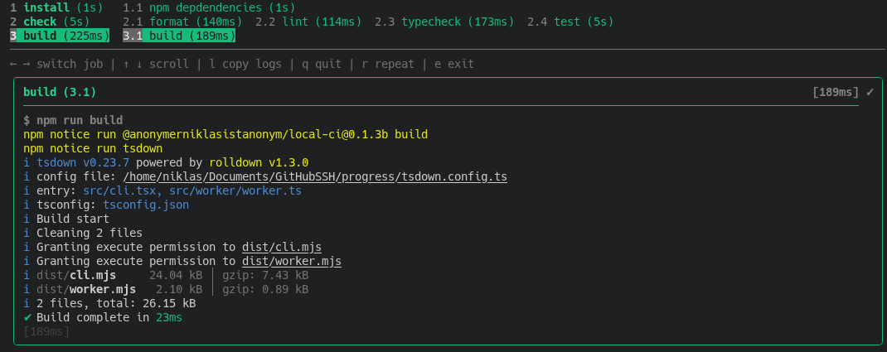
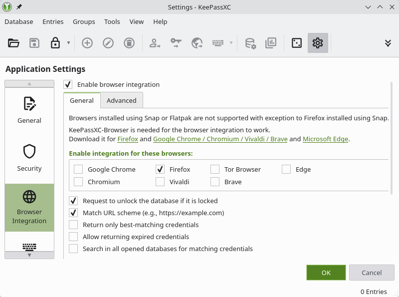
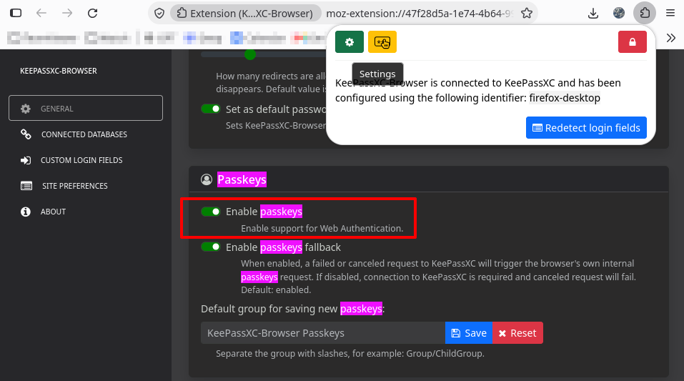
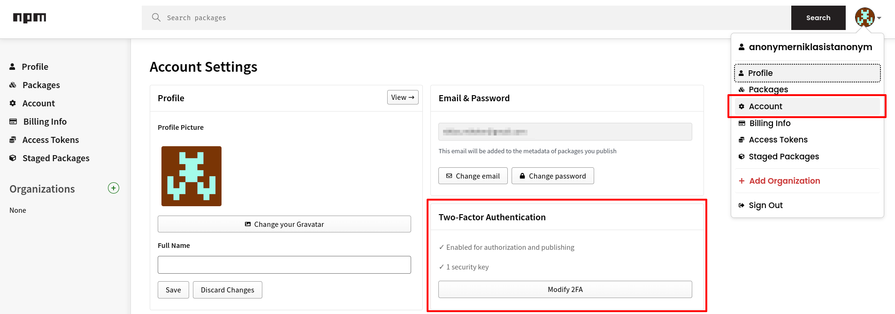
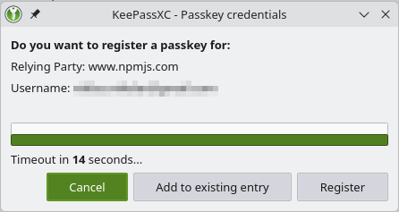
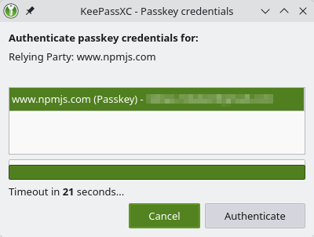
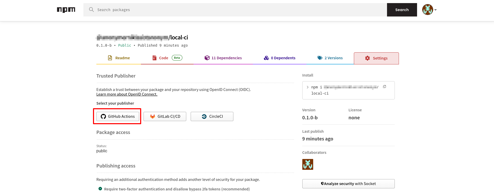

# local-ci

With this tool its possible to define a local CI pipeline which can for example be part of a git hook.
One of the reasons why this was created is that Powershell is horrible at running stuff in parallel (e.g. separate threads).

> [!WARNING]
> This is currently a WIP and not a working/finished project!
>
> TODOs:
>
> - [x] Log file support
> - [x] Correct return value
> - [x] Show return value of commands in output/logs
> - [ ] Early exit on pipeline failure
> - [ ] Filter jobs/stages
> - [x] Create a file log on demand
> - [ ] Update design
> - [x] If it fails in non-interactive render error log as is
> - [x] Select first failed (not allowed to fail) job when jobs fail
> - [x] Add buttons/keyboard key listeners (if in interactive mode)
>   - [x] Button to rerun pipeline
>   - [ ] Button to rerun job
>   - [x] Copy the full log of the current job to the clipboard

```
Usage: local-ci [options] [mode]

run your own local ci for example as part of a git hook

Arguments:
  mode                       what should be done (choices: "info", "run", default: "run")

Options:
  -V, --version              output the version number
  -v, --verbose              show extra info (default: false)
  -i, --interactive          do not close the program if its done to inspect logs (default: false)
  -f, --fullscreen           render in fullscreen (clears screen on exit) (default: false)
  --config <path>            path to your local-ci config (default: ".local-ci.json")
  --only <stages/labels...>  only run specific stages (test) or labels (:test) [allowlist]
  --skip <stages/labels...>  exclude specific stages (build) or labels (:test) [blocklist]
  --also <stages/labels...>  also run specific stages (build) or labels (:fix)
  -h, --help                 display help for command
```



## Configration

A configuration file has a fixed [JSON schema](./local-ci.schema.json) (but supports comments inside the JSON file).
The structure is very simple:

- A list of stages that are being run **in sequence**
- Each stage has a set of jobs that are being run **in parallel**
- Each job has a list of commands that will be run **in sequence**

To quickly enable/disable stages and stages each of them has the following properties:

- `label`: A list of strings that will run this job in case it is found as part of the CLI option list `--only :label`
- `mandatory`: Runs the job/stage even if it wasn't specified (like an `install` stage/job)
- `explicit`: Does not run the job/stage if it wasn't explicitly specified via a `label`

Example:

```jsonc
{
  "$schema": "./local-ci.schema.json",
  "name": "example",
  "stages": [
    {
      // Make sure that the dependencies are in sync
      "name": "install",
      "mandatory": true,
      "jobs": [
        {
          "name": "npm depdendencies",
          "commands": [["npm", "ci"]],
        },
      ],
    },
    {
      // Check that there are no format/lint or build issues
      "name": "check",
      "jobs": [
        {
          "name": "format",
          "allowedToFail": true,
          "commands": [["npm", "run", "format:check"]],
        },
        {
          "name": "format:fix",
          "explicit": true,
          "labels": ["fix"],
          "commands": [["npm", "run", "format"]],
        },
        {
          "name": "lint",
          "allowedToFail": true,
          "commands": [["npm", "run", "lint:check"]],
        },
        {
          "name": "lint:fix",
          "explicit": true,
          "labels": ["fix"],
          "commands": [["npm", "run", "lint"]],
        },
        {
          "name": "build",
          "commands": [["npm", "run", "build"]],
        },
      ],
    },
  ],
}
```

## Try it out

If `node` is installed and `npx` is available you can just run the following commands to try it out:

```sh
npx @anonymerniklasistanonym/local-ci --version
# Need to install the following packages:
# @anonymerniklasistanonym/local-ci@0.1.0-b
# Ok to proceed? (y) y
# npm notice run npx
# npm notice run 'local-ci' --version
# 0.1.0b
```

Create an example file `.local-ci.json`:

```json
{
  "name": "Example",
  "stages": [
    {
      "name": "hello world",
      "jobs": [
        {
          "commands": [["echo", "hello world"]]
        },
        {
          "commands": [["sleep", "10"]]
        }
      ]
    }
  ]
}
```

And then run it:

```sh
npx @anonymerniklasistanonym/local-ci --interactive
```

To remove the package from the `npx` cache simply:

```sh
npm cache npx ls
# b27ccf027b339910: @anonymerniklasistanonym/local-ci
npm cache npx rm b27ccf027b339910
# Or forefully remove all cached entries
npm cache npx rm --force
```

## Build

The following command generates the files:

- `dist/cli.mjs`
- `dist/worker.mjs`

```sh
npm install
npm run build
```

The file `cli.mjs` can then be run with:

```sh
npm run start
# or directly via node
node .
node dist/cli.mjs
# TODO Not supported any more, fix at some point
# or directly via node with permissions (but disable their warn messages)
node --disable-warning=PERM0002 --disable-warning=PERM0006 \
     --permission --allow-fs-read=* --allow-fs-write=* --allow-worker --allow-child-process \
     dist/cli.mjs
```

## Development

### Logs

Logs are created using `pino` in JSON format and are best viewed using:

```sh
# -L is the log level
# -m highlights specific strings in the output
cat local-ci.log | npx pino-pretty -L info -m optionalHighlight
```

## NPM

### Manual publishing

To publish on `npm` you first need to login:

```sh
# Displays a URL you need to visit and log in with your npm account
npm login
```

Then you need to enable 2FA which can for example be done using KeePassXC.
Create a new database and go to settings where you can enable the browser integration as well as get the link to the _official_ browser extension.



When the extension is installed you click the icon and connect it to your KeePassXC client.
Then you go to the extension settings and enable its _passkey_ integration:



> [!NOTE]
> I disabled the next option _Enable passkeys fallback_ but am not sure if this is necessary.

Now go back to the `npm` web page, select your profile and account and then _enable 2FA_.



When `npm` asks for a security key the KeePassXC client should now automatically pop up and prompts you to add a passkey.

> [!NOTE]
> The popup didn't show up on my first try but after I refreshed the page and clicked the button again it showed up.



Then you can publish:

```sh
npm run build
npm publish --access public
# or if its a beta version
npm publish --access public --tag beta
```

In the last step you are prompted to authenticate yourself by logging yourself in on the `npm` website which will again automatically trigger KeePassXC.



> [!NOTE]
> If your name is too generic, similar to existing projects or for other reasons you might be prompted to modify the name in `package.json` and prefix it with your username.

### GitHub Actions integration

For automatic publishing of new versions a trusted publisher must be added to your package.
For this login on the `npm` website and then go to the _Packages_ page where all published packages are located.
Select the one you want to automatically publish and go to the _Settings_ tab.



Then select for example _GitHub Actions_ and fill in the required information.
Make also sure to add a `repository` entry to the `package.json` which directly links to this repository.

> [!NOTE]
> Per default `npm` only allows staged publishing meaning you need to review the package before it will be released.
> If you want to directly publish you need to enable the checkbox for it to also directly publish.
